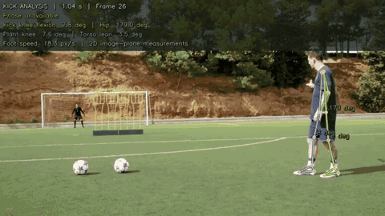

# Kicklab — Soccer kicking biomechanics CLI

Analyze penalties, free kicks, and general soccer shots directly from the terminal. The CLI tracks real 2D body landmarks, prints measurements and observations, and saves annotated video, graphs, CSV, JSON, and a text report. It runs locally without starting a web server or opening a browser.

## Demo — Messi’s free kick



## Run it now

The environment in this workspace is already installed:

```bash
cd /home/peeka/projects/soccer-analyzer
./run.sh /path/to/your/kick.mp4 --foot right --shot-type penalty
```

For the sample footage already in this workspace:

```bash
./run.sh input/instep_side.mp4 --foot right
```

Use `--foot left` for a left-footed player. Running `./run.sh` without arguments, or with `--help`, prints the CLI options. Paths containing spaces must be quoted. Relative input and output paths are resolved from your current working directory, including when calling `run.sh` by its absolute path from another directory.

The default output is `output/<video name>/`. Override it with:

```bash
./run.sh "my kick.mov" --foot left --shot-type free_kick --output "results/attempt 01"
```

The command exits after processing. Press Ctrl+C to cancel. No service needs to remain running.

## Folders

```text
input/                    Put your original MP4/MOV videos here.
output/<video name>/      Open the finished results here.
  overlay.mp4             Video with tracking and measurements.
  report.txt              Readable observations.
  metrics.png             Graphs and kick phases.
  .analysis/              Internal cache and detailed data (hidden).
```

Your downloaded video is `input/HnHF-si5rdk.mp4`:

```bash
./run.sh input/HnHF-si5rdk.mp4 --foot right
```

Older test files, download metadata, and legacy data are preserved in `.archive/data/`. You do not need them for normal use. Source code, dependencies, and tests remain in their development folders.

## Output files

| File | Contents |
| --- | --- |
| `overlay.mp4` | Annotated video with skeleton, joint measurements, phase labels, and zero-based frame numbers. |
| `.analysis/video.mp4` | Standardized video used for the measurements. |
| `metrics.png` | Measured time-series graphs and phase timeline; missing tracking stays blank. The dashed gold line marks selected or estimated contact. |
| `.analysis/metrics.csv` | Frame-by-frame measurements and visible landmarks. |
| `.analysis/report.json` | Full structured report, settings, quality notes, phases, and observations. |
| `report.txt` | Readable version of the terminal analysis. |
| `.analysis/pose.json` | Tracking cache for recalculation. |

Use `--no-plots` to omit the PNG export. This also removes a previous generated `metrics.png` in the chosen output folder so an outdated graph is not mistaken for the new analysis.

## Review contact and recalculate

Automatic contact is a foot-motion estimate, not ball-impact detection. Review `overlay.mp4` in a video player, read the frame number at foot–ball contact, then rerun using the same output folder:

```bash
./run.sh /path/to/kick.mp4 --foot right --output results/attempt-01

./run.sh /path/to/kick.mp4 --foot right --output results/attempt-01 \
  --contact-frame 346 --reuse-pose
```

Contact numbers refer to the standardized video and start at **0**. The example `346` is illustrative; choose the frame visible in your clip. All settings apply to the current invocation, so repeat your foot, camera, direction, and calibration flags when recalculating.

Additional options:

```text
--shot-type penalty|free_kick|shot
--camera-view side|oblique|front
--camera-motion fixed|moving
--direction auto|left|right
--scale-m-per-px NUMBER
--contact-frame INTEGER
--reuse-pose
--no-plots
--output DIRECTORY
```

Speed defaults to pixels per playback second. Supply a measured spatial scale only when it is known in the player's movement plane. Reused tracking must match the source and normalized-video SHA-256 hashes, cache version, frame timing, and dimensions. Damaged or obsolete caches are rebuilt. If rebuilding changes timing or image dimensions, prior contact/calibration settings are cleared with an explicit report note.

Source files are preserved. Output paths that would overwrite the source are rejected, and conversions use unique temporary files. Invalid input or detection failure prints a readable error and returns a nonzero exit code.

## Install on Ubuntu / WSL2

Use **Python 3.11 or 3.12**. Python 3.13/3.14 and newer MediaPipe APIs are incompatible with the pinned `mediapipe==0.10.14` runtime. Open the project in VS Code through **WSL: Open Folder in WSL** and select `.venv/bin/python` as the interpreter.

```bash
sudo apt-get update
sudo apt-get install -y libgl1 libglib2.0-0

# If uv is not installed:
curl -LsSf https://astral.sh/uv/install.sh | sh
source "$HOME/.local/bin/env"

uv python install 3.12
uv sync --locked --no-dev
./run.sh input/instep_side.mp4 --foot right
```

Or use pip with an installed Python 3.12:

```bash
python3.12 -m venv .venv
source .venv/bin/activate
python -m pip install -r requirements.txt
./run.sh /path/to/kick.mov --foot left
```

FFmpeg is provided by `imageio-ffmpeg`. No GPU, display server, browser, Node.js, FastAPI, or Uvicorn is required for the CLI. Graphs render through Matplotlib's noninteractive Agg canvas. Initial dependency installation needs internet access; processing runs offline using MediaPipe's bundled model.

`uv.lock` records the environment. Install interpreters outside `/tmp` so they survive reboots. If an old virtual environment points to a deleted temporary interpreter, recreate it with `uv sync --locked --no-dev`.

## Footage

Use one player and one kick per clip. Keep the entire player and ball in view, preferably from the side with a fixed camera and adequate light. Include the approach and follow-through. MP4 and MOV are supported, up to 120 seconds and 240 fps. Conversion normalizes orientation, pixel aspect ratio, and frame timing, limiting the analyzed image to 1280 pixels on either axis. Rational frame rates preserve fractional-rate timing; audio is padded or trimmed to video duration.

The optional sample is `input/instep_side.mp4`; source and review notes are in `.archive/data/examples/source.json`. It visibly plays in slow motion, its capture rate is unknown, and leg overlap causes tracking errors near contact. It demonstrates both functionality and measurement limitations. A fresh checkout without this optional video works with your own footage.

## Measurements and honest limits

All calculations use **2D image pixel coordinates**, never MediaPipe world coordinates or depth:

| Measurement | Definition |
| --- | --- |
| Kicking knee flexion | 180° minus the hip–knee–ankle interior angle; 0° is straight. |
| Kicking hip angle | Shoulder–hip–knee interior angle in the image, rather than anatomical 3D hip flexion. |
| Plant knee flexion | Same knee calculation on the opposite anatomical leg. |
| Torso inclination | Selected-side hip-to-shoulder inclination from upward image vertical, without a forward/backward claim. |
| Estimated foot speed | Smoothed foot-index trajectory differentiated over video time, in px/s unless spatially calibrated. It is not ball speed. |
| Plant motion | Opposite ankle displacement and knee variability over an explicitly stated support window; descriptive motion, not a balance diagnosis. |
| Follow-through | Observed forward foot excursion relative to the hip and its duration after contact, when continuous tracking permits it. |

Optional calibration is **meters per pixel of the analyzed video**, after resizing and orientation normalization. Divide a known length in meters by its pixel length in that video, measured in the player’s movement plane. A single scale cannot correct perspective or movement out of that plane. Speed always uses **playback seconds**: slow-motion or retimed files do not reveal actual real-time speed even after spatial calibration.

Landmarks below 0.5 visibility, off-image or invalid points, coincident segments, and missing poses produce gaps. Speed uses centered differences after approximately 0.12 seconds of quadratic Savitzky–Golay smoothing, separately within continuous visible runs. Endpoints have no speed. Potential left/right identity jumps are flagged; local leg measurements and nearby contact summaries are withheld rather than automatically relabeling the player. The model can still swap identities without triggering this heuristic. Always inspect the overlay.

The phase timeline uses tentative motion events: hip translation for approach, opposite-ankle slowing for plant placement, foot reversal relative to the hip for backswing/forward swing, a prominent relative-foot-speed peak for a contact candidate, and continuous forward motion for follow-through. Plant placement and approach require a declared fixed camera. Missing phases stay unclassified; physiological phases can overlap, and plant/contact events take display priority. Even manual contact does not validate other boundaries. Front/oblique views and moving cameras are explicitly flagged; these measurements do not reconstruct a sagittal or 3D view.

Feedback reports measured changes, windows, and limitations. There are **no power or accuracy predictions, performance scores, ideal-angle targets, or injury assessments**. Algorithm parameters filter tracking or locate signal events; they are not normative technique thresholds. The report includes metric definitions, algorithm notes, tracking coverage, and a background biomechanics reference that does not validate this implementation.

## Optional batch processing

```bash
uv sync --no-dev --group batch
# Put MP4/MOV clips in input/, then:
uv run --no-dev --group batch snakemake --cores 1 --config foot=right
```

Each input is analyzed as a single attempt. For individual camera, calibration, or contact settings, invoke the CLI separately with an explicit output directory.

## Verification

```bash
uv sync --locked
uv run pytest -q
uv run python -m compileall -q src scripts tests

# Real footage through the standalone CLI, including plots and cached contact updates:
KICKLAB_RUN_VIDEO_E2E=1 uv run pytest tests/test_cli.py -q
```

Tests cover exact 2D geometry, missing landmarks, source preservation, pose-cache integrity, phone rotation, fractional frame rates, audio duration, readable errors, relative paths, and the absence of web imports in CLI entry points. The real-footage CLI test explicitly skips if the optional sample or opt-in environment variable is absent. No motion-capture ground truth is available; software verification does not establish laboratory measurement accuracy.

The earlier dashboard source is retained as an optional component and is not imported or started by the CLI. Its packages live in the optional `dashboard` / `dashboard-test` dependency groups. To run its existing regression tests when working on that component, use `uv sync --group dashboard-test` and `uv run --group dashboard-test pytest`. They skip when those optional dependencies are absent.

## Architecture

- `run.sh`, `scripts/analyze_kick.py`: standalone command-line launcher and analysis orchestration.
- `src/settings.py`: validated settings independent of any server framework.
- `src/cli_report.py`: readable terminal/text reports and offline PNG graphs.
- `src/pipeline.py`: normalization, cache validation, measurements, video rendering, and CSV/JSON exports.
- `src/extractor.py`: headless MediaPipe extraction of visible image-plane landmarks on both sides.
- `src/math_utils.py`, `src/physics_utils.py`: geometry, kinematics, quality checks, tentative phases, and observations.
- `src/renderer.py`: skeletal and numerical overlays encoded as H.264 MP4.
- `Snakefile`: optional batch processing.

Legacy source videos and intermediate files are preserved in `.archive/data/` and excluded from Git.
